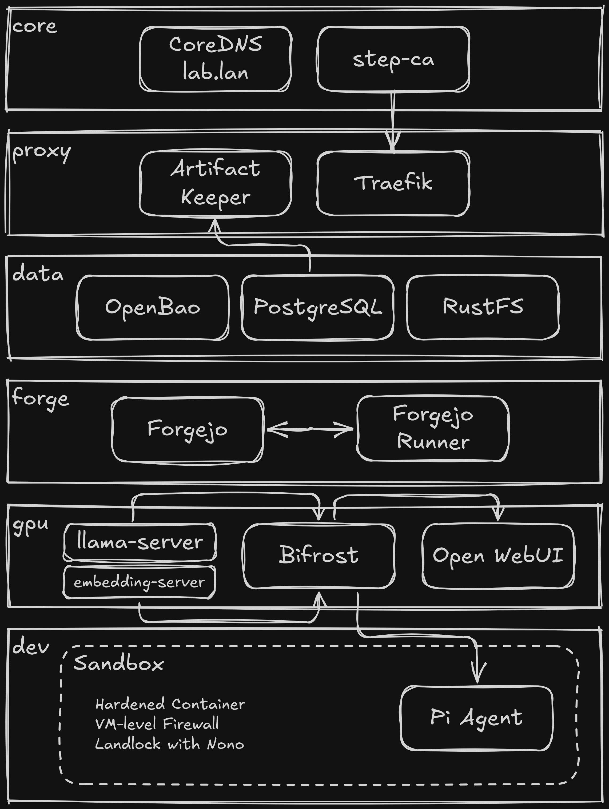

## Summary

In this video, we go through the infrastructure architecture, our IaC project structure, and overall design decisions.

This series picks up where Data Lab Infra left off, but it has a broader scope, including for example the deployment of an Agentic AI stack, or a Forgejo local instance with a working CI runner, used to build a custom bootc image for Bazzite. Everything is done with resource to IaC, as a combination of Just for orchestration, OpenTofu for VM provisioning, and Ansible for system configuration and Quadlet deployment. We also cover sandboxing and quadlets lightly.

    <iframe
        src="https://www.youtube.com/embed/GYjz2GAYUL4"
        frameborder="0"
        allow="accelerometer; autoplay; clipboard-write; encrypted-media; gyroscope; picture-in-picture; web-share"
        referrerpolicy="strict-origin-when-cross-origin"
        allowfullscreen
        style="position: absolute; top: 0; left: 0; width: 100%; height: 100%;">
    ></iframe>

## Architecture Diagram

Here you can view the architecture diagram for the homelab infrastructure redesign, where each tier is a VM in Proxmox, and each service is a Quadlet deployed in one of those VMs. VMs are provisioned with OpenTofu and configured with Ansible, while Quadlets are deployed and configured with Ansible and Jinja2 templates.

